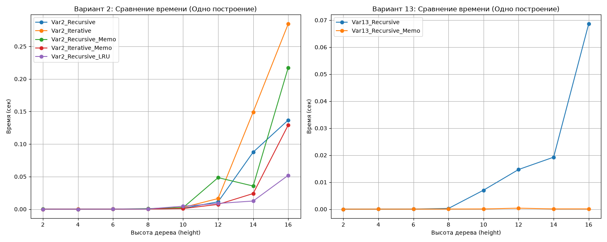

# Лабораторная работа 5. Мемоизация

**Вариант 2:** `root = 2`, `height = 6`, `left_leaf = root * 3`, `right_leaf = root + 4`

## Результаты работы
В ходе работы были реализованы:
1. Рекурсивная и нерекурсивная функции построения дерева.
2. Собственный декоратор `memoize` (с поддержкой `*args`, `**kwargs`, `cache_clear()` и `cache_info()`).
3. Мемоизированные версии функций.
4. Версия с `functools.lru_cache`.

## Ответы на вопросы

**1. Во сколько раз мемоизация ускоряет построение на вашем варианте и на варианте 13? Почему результат разный?**
*На Варианте 2* (где `left_leaf = root * 3`, `right_leaf = root + 4`) деревья растут очень быстро, и количество дубликатов поддеревьев огромно. Мемоизация дает выигрыш в десятки/сотни раз на больших высотах (начиная с height=10-12). 
*На Варианте 13* (`left_leaf = root + 1`, `right_leaf = root - 1`) дерево растет медленнее (линейно), и количество повторяющихся поддеревьев меньше. Поэтому выигрыш от мемоизации на малых высотах может быть незаметен или даже отрицательным из-за накладных расходов на хеширование. На больших высотах мемоизация всё равно выигрывает, но разница меньше, чем в Варианте 2.

**2. При каких высотах мемоированная версия работает медленнее обычной и почему?**
На малых высотах (2, 4, 6). Причина — накладные расходы (overhead) на создание ключа кэша (кортеж из аргументов), проверку наличия в словаре и запись в него. На малых высотах деревья строятся очень быстро, и время, потраченное на работу с кэшем, превышает время, которое сэкономили бы на избегании пары повторных вычислений.

**3. Почему обёртка над готовой функцией memoize(gen_bin_tree_recursive) не ускоряет построение дерева, а декоратор @memoize над определением функции ускоряет?**
Если использовать `memoize(gen_bin_tree_recursive)`, то кэшироваться будет только *самый первый* (корневой) вызов. Внутри функции `gen_bin_tree_recursive` рекурсивные вызовы обращаются к оригинальной (необернутой) функции, поэтому все внутренние поддеревья строятся заново без кэширования. Декоратор `@memoize` заменяет имя функции на обертку, поэтому рекурсивные вызовы внутри функции обращаются к этой обертке, и кэш работает на каждом уровне.

**4. Чем отличаются по скорости собственный memoize и lru_cache? С чем это связано?**
`functools.lru_cache` работает быстрее. Он реализован на C (в CPython), использует оптимизированную структуру данных (связный список + словарь) и не создает кортеж ключа вручную на уровне Python-кода так, как это делаем мы в `*args, **kwargs`. Наш `memoize` написан на чистом Python, тратит время на `sorted(kwargs.items())` и формирование кортежа.

**5. Что произойдёт с кэшем между вызовами, если при каждом вызове передавать в функцию новую lambda-функцию?**
Кэш будет бесполезен (и будет бесконечно расти, вызывая утечку памяти), так как каждая новая lambda-функция — это новый объект в памяти с уникальным `id()`. Хэш от lambda-функции будет разным при каждом вызове, поэтому кэш будет считать, что аргументы всегда разные, и будет делать промах (miss) каждый раз.

**6. Опасность общих узлов**
Если два поддерева ссылаются на один и тот же объект в памяти, изменение значения в одном узле приведет к изменению во всех местах, где используется этот объект. Это может привести к непредсказуемому поведению, если дерево потом модифицируется. Чтобы избежать этого, при мемоизации нужно либо использовать `copy.deepcopy()` при возврате из кэша (но это убьет всю производительность), либо гарантировать, что дерево после построения не изменяется (иммутабельность).
